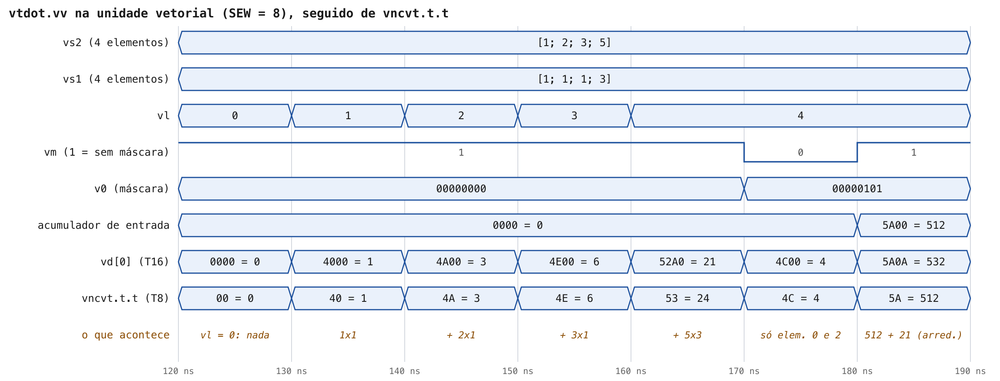

# Entrega 2 — Zvtakum completo, simulador RVV e avaliação experimental

**Projeto Integrador AOC 2026/02**

Cobre as semanas 5 a 8 do cronograma: Fase 2 (`vtdot.vv`, `vncvt.t.t`, integração num modelo de simulação
RVV), Fase 3 (SpMV, erro relativo contra Float128, contagem de instruções e CSRs) e os documentos finais.

| Entregável | Onde |
|---|---|
| Artigo (IEEE, inglês, 5 páginas) | [`docs/artigo/artigo.pdf`](artigo/artigo.pdf) |
| Artigo, versão em português | [`docs/artigo/artigo-pt.pdf`](artigo/artigo-pt.pdf) |
| Guia do projeto: tudo explicado passo a passo (15 páginas) | [`docs/entrega2/guia.pdf`](entrega2/guia.pdf) |
| Slides da apresentação (15 min) | [`docs/slides/slides.pdf`](slides/slides.pdf) |
| RTL | `rtl/` |
| Testes do RTL e oráculo | `tb/` |
| Simulador RVV + Zvtakum e benchmarks | `sim/` |
| Matrizes reais (Matrix Market) | `data/matrixmarket/` |
| Dados dos experimentos | `results/` |

## 1. Arquivos novos

```
rtl/takum_ncvt.v      vncvt.t.t: T(2N) -> T(N), arredondando a palavra
rtl/takum_wmul.v      multiplicação com alargamento: T(N) x T(N) -> T(2N), exata
rtl/takum_dot.v       núcleo do vtdot.vv: produtos e acúmulo em 2N bits
rtl/takum_vec_alu.v   (estendida) 5 instruções, vl, máscara v0.t
rtl/takum_alu.v       (alterada) parâmetro MUL e suporte a N = 64, para o acumulador do T32
tb/tb_unary.v         testa takum_ncvt e takum_wmul
tb/libtakum_check.c   compara os vetores com a libtakum (referência do autor do formato)
tb/libtakum_report.py decide cada divergência com aritmética exata
tb/tb_demo2.v         demonstração de ondas da Fase 2
tb/waves.py           desenha as ondas a partir do VCD (SVG, PDF, PNG)
tb/schematics.py      desenha os esquemáticos (Yosys + netlistsvg)
sim/formats.py        takum (via oráculo) e IEEE 754 genérico, corretamente arredondados
sim/isa.py            montador, codificação e decodificação de 32 bits
sim/rvv.py            a máquina: busca, decodifica, executa, conta instruções
sim/kernels.py        y = A x (CSR) em assembly: takum, IEEE e IEEE com alargamento
sim/bench.py          Fase 3: matrizes, execução, erro relativo, contagens -> results/
sim/test_sim.py       autotestes do simulador
sim/demo.py           demonstração com rastro das instruções
sim/paper_numbers.py  gera as tabelas do artigo a partir de results/
```

## 2. Instruções da Zvtakum

| `op` (RTL) | Instrução | `funct6` | Semântica (`i < vl`, não mascarado) |
|---|---|---|---|
| 0 | `vtadd.vv vd, vs2, vs1` | `000000` | `vd[i] = vs2[i] + vs1[i]` |
| 1 | `vtsub.vv vd, vs2, vs1` | `000010` | `vd[i] = vs2[i] - vs1[i]` |
| 2 | `vtmul.vv vd, vs2, vs1` | `100100` | `vd[i] = vs2[i] * vs1[i]` |
| 3 | `vtdot.vv vd, vs2, vs1` | `111001` | `vd[0]` (2·SEW) `+= Σ vs2[i] * vs1[i]`, em ordem |
| 4 | `vncvt.t.t vd, vs2` | `010010`, `vs1 = 10100` | `vd[i]` (SEW) `= arredonda(vs2[i]` de 2·SEW`)` |

Codificação: layout do OP-V (`funct6 | vm | vs2 | vs1 | funct3 | vd | opcode`), opcode *custom-2*
(`1011011`), `funct3 = 001`, e o `funct6` da instrução de ponto flutuante equivalente (`vfadd`, `vfsub`,
`vfmul`, `vfncvt.f.f.w`). Um núcleo só-takum poderia usar diretamente as codificações OPFVV.

Elementos da cauda (`i ≥ vl`) e mascarados (`vm = 0` e `v0[i] = 0`) ficam inalterados. No `vtdot.vv` só
`vd[0]` é escrito e, com `vl = 0`, nada muda, como nas reduções do RVV.

## 3. Decisões de projeto

| Decisão | Escolha | Motivo |
|---|---|---|
| "Acúmulo em precisão ampliada" | Produtos e somas em takum de 2·SEW | O produto dos significandos (2N−8 bits) cabe sempre na fração do takum de 2N bits: o produto é **exato** (salvo saturação). Só as somas arredondam, em dobro de largura. |
| Alternativa descartada | Acumulador exato de ponto fixo (*quire*) | Com faixa 2^±255 teria mais de mil bits. |
| Onde fica o acumulador | Em `vd[0]`, lido e escrito pela instrução | O laço com `vsetvli` não precisa de redução separada nem trocar `vtype`. |
| Ordem do acúmulo | Sequencial, elemento 0 primeiro | Determinística, igual à do `vfredosum`; o resultado não depende de VLEN. |
| `vncvt.t.t` | Arredonda a cadeia de bits, sem decodificar | O cabeçalho fica no topo em qualquer largura e o takum é monótono. |
| T32 | Acumulador em T64 | Mesma regra das outras larguras; `takum_alu` passou a aceitar N = 64. |
| Modelo de simulação | Simulador de instruções próprio, em Python | A guideline admite simulador funcional; permite contar instruções e comparar com IEEE no mesmo ambiente. O RTL e o simulador são amarrados pelos mesmos vetores. |
| Referência "Float128" | binary128 com arredondamento correto, sobre os dados originais | Mede também o erro de arredondar as entradas para o formato. |
| FP8 | Divisão de campos do E4M3 sob as regras do IEEE 754 (com ±∞, NaN e subnormais) | O enunciado pede a comparação "contra o padrão IEEE 754 (FP8, FP16 e FP32)" e o padrão não define formato de 8 bits: aplicamos ao FP8 as mesmas regras do FP16 e do FP32, de modo que os três são uma única aritmética em três larguras (um só modelo no simulador), simétrica ao takum. O OFP8 é outra norma (seu E4M3 não tem infinitos); usá-lo só nos 8 bits misturaria duas normas. Consequência: parte dos infinitos do nosso FP8 seria saturação no OFP8. |
| IEEE justo | Variante `ieee_w`: `vfwmul` + soma em 2·SEW + `vfncvt` | Dá ao IEEE o mesmo acúmulo ampliado do `vtdot.vv`; separa o efeito do formato do efeito do alargamento. |

## 4. Verificação

`make test` roda tudo. Resultado atual:

| Teste | Casos |
|---|---|
| Decodificador, ida e volta, codificador | 855 408 |
| ALU T8 (todos os pares × 3 operações) | 196 608 |
| ALU T16 / T32 | 109 923 cada |
| `vncvt.t.t`: T16→T8 (**todas** as 65 536 palavras), T32→T16, T64→T32 | 65 536 + 20 129 + 20 129 |
| Produto alargado: T8 (**todos** os pares), T16, T32 | 65 536 + 36 641 + 36 641 |
| Unidade vetorial, SEW 8/16/32: 5 instruções, `vl`, máscara, cauda | 5 000 cada |
| Simulador: IEEE × ponto flutuante nativo | 160 000 |
| Simulador: Zvtakum × os vetores do RTL, como instruções codificadas | 15 000 |

**Conferência contra a libtakum** (`make libtakum`). O hardware e o oráculo foram escritos por nós; para
descartar um erro comum aos dois, os mesmos vetores foram comparados com a
[libtakum](https://github.com/takum-arithmetic/libtakum) 2.0.0, a implementação de referência do autor
do formato (licença ISC; é baixada em `build/ext/`, não fica no repositório).

| Comparação | Vetores | Resultado |
|---|---|---|
| Decodificar e recodificar (T8 e T16 completos, T32 amostrado) | 165 921 | idênticos |
| Soma, subtração, produto: T8 (todos os pares) e T16 | 306 531 | idênticos |
| Soma, subtração, produto: T32 | 109 923 | 16 diferem no último bit |
| `vncvt.t.t` | 105 794 | idênticos |
| Produto alargado | 138 818 | idênticos |

As 16 divergências são produtos em T32: a libtakum calcula em `double` (53 bits) e o produto pode ter 56,
então ela arredonda duas vezes. `tb/libtakum_report.py` confere cada caso com frações exatas: em todos, o
resultado exato está mais perto do valor do projeto. Em Macs com processador ARM a suíte de testes da
própria libtakum falha; por isso o alvo a compila para x86-64 e a executa via Rosetta.

Defeitos injetados de propósito nos blocos novos (todos detectados):

| Defeito | Divergências |
|---|---|
| `vncvt` sem empate para o par | 3 633 |
| `vncvt` sem *sticky* | 24 792 |
| `vncvt` sem saturar em MINPOS | 283 |
| produto alargado sem normalizar | 102 716 |
| `vtdot` ignora `vl`/máscara | 1 795 |
| `vtdot` acumula em ordem inversa | 1 291 |
| unidade vetorial ignora `v0` | 3 783 |
| `vtdot` ignora o acumulador de entrada | 1 857 |

Somados aos cinco da Entrega 1, são 13.

`make lint` (Verilator) não foi rodado nesta entrega: o Verilator não está instalado na máquina usada.

## 4.1 Esquemáticos e formas de onda

`make schematic` (Yosys + netlistsvg) desenha todos os módulos em `docs/img/`, em SVG, PDF e PNG, sem
achatar a hierarquia: [`takum_ncvt`](img/takum_ncvt.png), [`takum_wmul`](img/takum_wmul.png),
[`takum_dot`](img/takum_dot.png), [`takum_alu`](img/takum_alu.png), além dos três da Fase 1.

`make waves2` simula `tb/tb_demo2.v` e desenha as ondas com `tb/waves.py`, sem GTKWave, anotando cada
barramento com o valor takum decodificado:

- [`ondas-fase2-ncvt`](img/ondas-fase2-ncvt.png): truncar, arredondar, os dois empates, saturar, negativo, NaR;
- [`ondas-fase2-wmul`](img/ondas-fase2-wmul.png): 5 × 3 dá 16 em T8 e 15 em T16;
- [`ondas-fase2-vtdot`](img/ondas-fase2-vtdot.png): o acumulador crescendo com `vl`, a máscara e o acumulador de entrada.



## 5. Simulador

```bash
make simtest    # autotestes
make simdemo    # produto escalar T16 com vtdot.vv, mostrando cada instrução executada
make bench      # Fase 3 completa (cerca de 2 minutos) -> results/
```

A máquina (`sim/rvv.py`) tem 32 registradores inteiros, 32 vetoriais de `VLEN` bits, memória, `vl`,
`vtype` e os `fflags` do IEEE. Busca palavras de 32 bits, decodifica e executa. Suporta grupos de
registradores (LMUL > 1), necessários ao `vfwmul` e à carga indexada com índices de 32 bits.

Simplificações: `vstart = 0`; cauda e mascarados sempre inalterados; só arredondamento para o mais
próximo; o zero negativo do IEEE não é modelado.

## 6. Experimento (Fase 3)

`y = A x` com `A` em CSR, em nove matrizes (`results/matrices.csv`).

Quatro **geradas**, com semente fixa:

| Matriz | Descrição |
|---|---|
| `poisson` | Laplaciano 2D de 5 pontos (malha 16×16) aplicado a um modo suave: forte cancelamento |
| `gauss` | esparsa aleatória, 10 por linha, valores N(0, 1) |
| `wide` | mesma estrutura, magnitudes log-uniformes: \|a\| em 2^[−10, 10], \|x\| em 2^[−6, 6] |
| `mlp` | camada densa podada (256×512, 90% de zeros), pesos N(0, 2/fan_in), entrada pós-ReLU |

Cinco **reais**, baixadas do repositório público Matrix Market (NIST) (quatro da coleção Harwell-Boeing
e a `memplus`, a matriz grande do experimento) e guardadas em [`data/matrixmarket/`](../data/matrixmarket/LEIAME.md); `x` é N(0, 1) com semente fixa:

| Matriz | Origem | Dimensão | Não nulos | Faixa de \|a\| |
|---|---|---|---|---|
| `nos4` | análise estrutural (viga) | 100×100 | 594 | 2^−6 a 2^−1 |
| `bus494` (`494_bus`) | rede elétrica de 494 barras | 494×494 | 1 666 | 2^−3 a 2^14 |
| `west0479` | engenharia química (coluna de destilação) | 479×479 | 1 910 | 2^−21 a 2^18 |
| `bcsstk05` | matriz de rigidez estrutural | 153×153 | 2 423 | 2^−31 a 2^22 |
| `memplus` | simulação de um circuito de memória | 17 758×17 758 | 126 150 | 2^−86 a 2^0 |

Erro relativo mediano contra binary128 (`results/spmv_summary.csv`; `T` usa `vtdot.vv`, `FPw` é o IEEE com
acúmulo ampliado; ∞ = mais da metade das linhas não é finita):

| | poisson | gauss | wide | mlp | nos4 | bus494 | west0479 | bcsstk05 | memplus |
|---|---|---|---|---|---|---|---|---|---|
| T8 | 1,6 | 6,8e-2 | 2,1e-1 | 7,7e-2 | 1,1e-1 | 1,4e-1 | 5,7e-2 | 5,4e-1 | 1,4e-1 |
| FP8 | 1,6 | 7,7e-2 | ∞ | 9,0e-2 | 5,4e-2 | 6,4e-2 | 4,4e-2 | ∞ | 7,2e-2 |
| FP8w | 1,7 | 4,4e-2 | ∞ | 4,1e-2 | 3,8e-2 | 5,1e-2 | 3,6e-2 | ∞ | 6,4e-2 |
| T16 | 6,9e-3 | 2,7e-4 | 8,4e-4 | 2,5e-4 | 2,6e-4 | 5,4e-4 | 2,3e-4 | 2,0e-3 | 5,8e-4 |
| FP16 | 9,1e-3 | 4,7e-4 | 3,8e-4 | 6,7e-4 | 3,9e-4 | 3,5e-4 | 2,9e-4 | ∞ | 3,8e-4 |
| FP16w | 9,0e-3 | 3,2e-4 | 2,4e-4 | 3,2e-4 | 3,0e-4 | 3,1e-4 | 2,4e-4 | ∞ | 3,1e-4 |
| T32 | 9,9e-8 | 4,2e-9 | 1,4e-8 | 3,4e-9 | 3,7e-9 | 8,3e-9 | 3,8e-9 | 3,3e-8 | 8,6e-9 |
| FP32 | 1,2e-6 | 6,9e-8 | 5,2e-8 | 1,0e-7 | 4,6e-8 | 5,2e-8 | 3,7e-8 | 6,2e-8 | 4,8e-8 |
| FP32w | 9,3e-7 | 4,3e-8 | 3,1e-8 | 3,8e-8 | 3,5e-8 | 3,8e-8 | 3,0e-8 | 4,0e-8 | 3,8e-8 |

Linhas com resultado infinito ou NaN (núcleos com acúmulo ampliado; o takum não tem nenhuma):

| | wide (256) | bus494 (494) | west0479 (479) | bcsstk05 (153) |
|---|---|---|---|---|
| FP8w | 217 | 94 | 51 | 153 |
| FP16w | 0 | 0 | 5 | 149 |

Leitura:

- **32 bits:** o takum tem o menor erro mediano nas nove matrizes (1,2 a 11 vezes menos que o FP32w).
- **16 bits:** ganha perto da escala unitária (`poisson`, `gauss`, `mlp`, `nos4`, `west0479`); **perde** em
  `wide`, `bus494` e `memplus`, porque em 2^±10 o T16 tem 8 bits de fração e o binary16 tem 10; e continua finito onde
  o binary16 estoura (`bcsstk05`, `west0479`).
- **8 bits:** dentro da faixa, o FP8 é **mais preciso** que o T8 (1,5 a 3 vezes na mediana). Mas ele sai da
  faixa em quatro das nove matrizes, três delas reais; o T8 responde em todas as linhas. Na `memplus` o
  problema do FP8 é *underflow*: erra 100% ou mais em 1 054 das 17 758 linhas, contra 267 do T8. Em `poisson`
  nenhum formato de 8 bits serve.
- **Matriz grande:** a `memplus` (17 758 linhas) repete o padrão das pequenas: T32 à frente (4,4 vezes),
  T16 e T8 atrás na mediana. As conclusões não dependiam do tamanho.
- O acúmulo ampliado reduz o erro mediano do takum de 1,2 a 2,3 vezes (linhas `T8s`, `T16s`, `T32s` do CSV,
  calculadas com `vtmul` + `vtadd` em SEW).

Também estão no CSV o bfloat16 e o E5M2, e a melhor resposta possível em cada formato (sufixo `opt`).

**Instruções executadas** (VLEN = 128, `results/spmv_instr.csv`): o laço interno tem 11 instruções com
`vtdot.vv`, 12 com `vfmul` + `vfredosum` e 13 com alargamento (que precisa de um segundo `vsetvli`).
A economia frente ao `FPw` vai de 7,7% a 14,3%; frente ao IEEE simples, de 0 a 7,1%. Ela cresce com o
número de não nulos por linha: as matrizes reais, com 3 a 7 por linha, ficam no extremo baixo.
`results/instr_vlen.csv` repete a contagem para VLEN de 64 a 512.

**CSRs:** o IEEE usa `frm` (3 bits) e `fflags` (5 bits). Nas execuções, até 90% das operações levantaram
algum flag, e o FP8 em `wide` terminou com NX, UF, OF e NV ligados. A Zvtakum não lê nem escreve CSR além
de `vl` e `vtype`. Comparações, mínimo/máximo, injeção de sinal e classificação não precisam de instruções
próprias: as inteiras já servem.

## 7. Custo de hardware (Yosys, síntese genérica, LUT6)

`make synth` e `make synth2`; números em `results/synth.txt` e na Tabela IV do artigo.

## 8. Limitações

- RTL combinacional, sem temporização nem lugar-e-rota; sem comparação de área com uma ALU IEEE.
- O `vtdot.vv` combinacional instancia um somador de 2N bits por pista; uma implementação real iteraria.
- T16 e T32 não são exaustivos.
- Só uma matriz grande (`memplus`); as demais têm no máximo 494 linhas. O simulador conta instruções, não ciclos.
- Só `vl ≤ VLEN/(2·SEW)` elementos no `vncvt.t.t` da unidade RTL (a origem ocupa o registrador inteiro).

## 9. Reproduzir

```bash
make test                      # RTL + simulador
make bench                     # experimentos -> results/
make synth && make synth2      # síntese (demora alguns minutos)
python3 -m sim.paper_numbers   # atualiza docs/artigo/numbers.tex
make paper                     # artigo e slides (requer LaTeX com IEEEtran, pgfplots e beamer)
```
